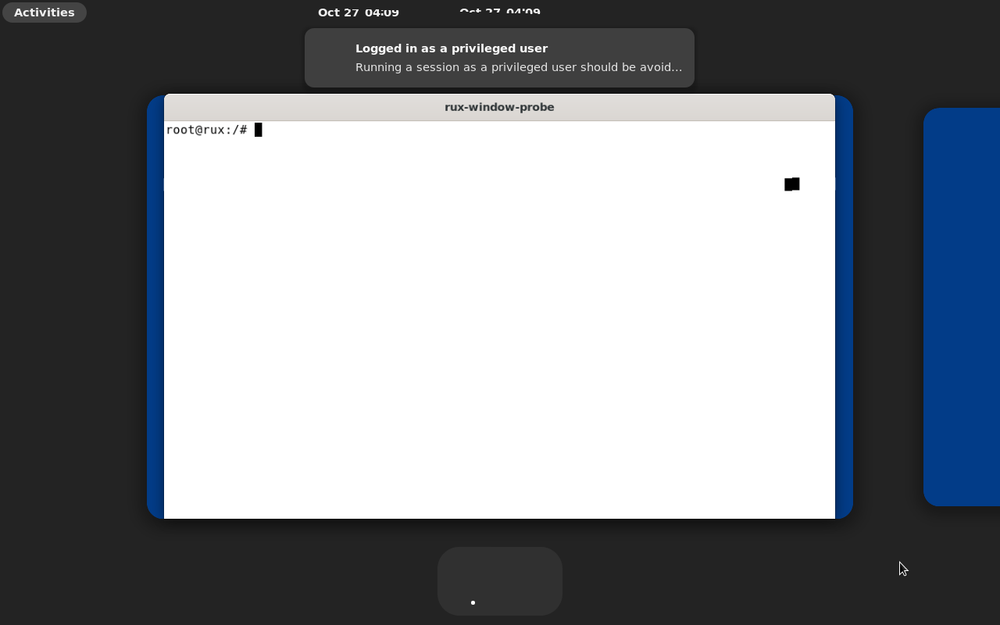

# Rux

<div align="center">

**A Linux-compatible kernel, ~250,000 lines of Rust — written entirely by AI.**

[](https://www.rust-lang.org/)
[](LICENSE)
[](#-platforms)
[](#-numbers)
[](docs/architecture/structure.md)

Stock Ubuntu 22.04 boots to a GNOME Shell desktop.
Stock OpenHarmony boots to its full ~80-service system.
**Not one line of userspace code was changed.**

</div>

---

## ⚡ The highlights

- **100% AI-written.** Every line — scheduler, memory manager, ext4, binder,
  network stack, the formal proofs — generated by AI agents
  (Claude Code + GLM) under human direction. The human sets the goal;
  the AI writes the code, finds the bugs, and proves the fixes.
- **Binary-compatible with Linux.** 345+ syscalls with exact reference
  semantics, ELF/auxv, futex, SysV/POSIX IPC, binder, ext4 on disk,
  `/proc` · `/sysfs` · `/debugfs` · tracefs shapes, down to the
  `uname` strings glibc's loader keys off. LTP: **1,005 / 1,869**.
- **Compatible outside, better inside.** The ABI is the contract; the
  implementation is ours. Every deliberate divergence carries measured
  evidence in the
  [design-divergence register](docs/architecture/design-divergences.md) —
  13 entries. Example: one **global run queue** instead of per-CPU
  queues + a load balancer — no balancer heuristics, no fairness bugs,
  5.1–6.1 µs flat hold; the mainstream design only wins at core counts
  we don't target.
- **Safety enforced, not hoped for.** ~4,900 `unsafe` sites, each with
  a written safety contract. **Kani** proves core unsafe code for *all*
  inputs (157 harnesses); **proptest** (1,088+), **SPIN** (4 models)
  and **Miri** back it up. Mirror-sync tooling keeps the proofs pinned
  to the code they cover.
- **Three architectures, one source.** riscv64 (primary) · x86_64 ·
  aarch64 — each to a booting shell, Ubuntu on two of the three.

---

## 🖥️ Ubuntu 22.04 → GNOME Shell desktop



*Unmodified Ubuntu userland: glibc, Xorg, D-Bus, GNOME Shell + mutter,
interactive xterm. Sessions hold 45 min, zero panics.*

```bash
make ubuntu-image && make ubuntu-run    # boot-to-login ~4.5 s, login: root / rux
```

## 📱 OpenHarmony → launcher


*Unmodified OH x86_64_virt image: samgr, foundation, render_service,
hilogd, appspawn, hdf devhosts — 135+ services, launcher home screen,
`hdc shell` to the live guest.*

---

## 🦾 Platforms

| | riscv64 | x86_64 | aarch64 |
|---|---|---|---|
| Boot to shell | ✅ | ✅ | ✅ |
| Ubuntu / GNOME | ✅ | ✅ | bring-up |
| OpenHarmony | — | ✅ | — |
| In-kernel tests | 1,122 | ✅ | 1,119 |

```bash
make build                        # riscv64
make build-x86                    # x86_64
make build PLATFORM=aarch64       # aarch64
make test [PLATFORM=…]            # in-kernel unit tests
make verify && make kani          # proofs
```

---

## 📊 Numbers

| | |
|---|---|
| Kernel source | ~249,500 lines, 399 files |
| Syscalls dispatched | 345+ |
| Kernel unit tests | 1,122 (riscv64) · 1,119 (aarch64), all green |
| Formal verification | 1,116+ functions · 157 Kani proofs · 4 SPIN models |
| Linux LTP | **1,005 / 1,869** (35 → 524 → 801 → 945 → 1,005) |
| Swap under load | 2,064 MiB working set through 256 MB swap, verified |
| Boot to Ubuntu login | ~4.5 s (4-CPU MTTCG) |
| Design divergences | 13 registered, each with compatibility evidence |

---

## 📚 Documentation

[Getting Started](docs/guides/getting-started.md) ·
[Roadmap](docs/progress/roadmap.md) ·
[Design Divergences](docs/architecture/design-divergences.md) ·
[Formal Verification](docs/development/formal-verification.md) ·
[Lock Ordering](docs/architecture/lock-ordering.md) ·
[Review Coverage](docs/development/review-coverage.md) ·
[Changelog](docs/progress/changelog.md)

---

## 📄 License

MIT — see [LICENSE](LICENSE).

<div align="center">

**Human sets the goal. AI writes the kernel.**

[Project Home](https://github.com/topkernel/rux) · [Issues](https://github.com/topkernel/rux/issues)

</div>
