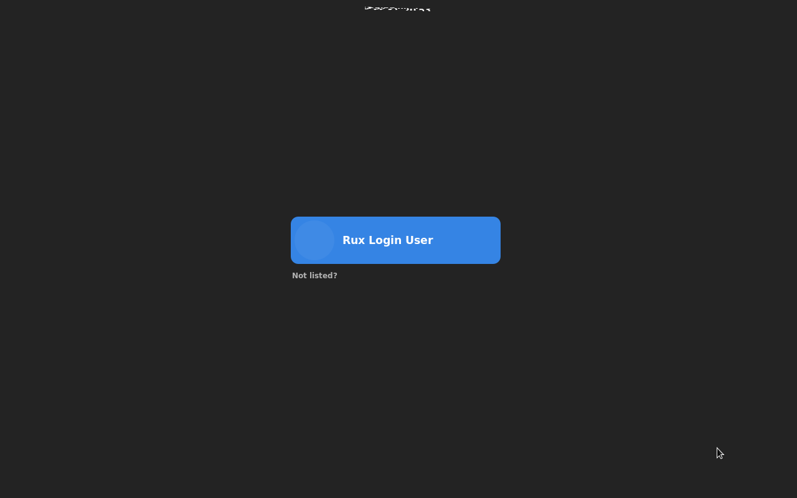

# Rux

<div align="center">

**A Linux-compatible kernel, ~391,000 lines of Rust — written entirely by AI.**

[](https://www.rust-lang.org/)
[](LICENSE)
[](#platforms)
[](#numbers)
[](docs/architecture/structure.md)

Unmodified Ubuntu 22.04 boots to a GNOME Shell desktop.
Unmodified OpenHarmony boots 135+ services to an interactive launcher.
No userspace patches, rebuilds, or configuration changes.

**Documentation & reports: <https://topkernel.github.io/Rux/>** (中文 / EN)

</div>

---

## Overview

- **Developed entirely by AI agents.** All code — scheduler, memory
  management, ext4, binder, the network stack, the verification
  harnesses — was written by AI agents under human direction. Humans
  set objectives, review changes, and hold merge authority; agents
  implement, test, and debug. Over 1,000 commits on main since
  November 2026 alone, from 100+ numbered agent sessions.
- **Linux ABI compatibility.** 345+ system calls with semantics
  matched against the reference implementation; ELF/auxv, futex,
  SysV and POSIX IPC, binder, on-disk ext4, and the `/proc`,
  `/sysfs`, `/debugfs`, tracefs layouts, down to the `uname` strings
  glibc's loader keys on. Linux Test Project: **1,084 / 1,869**
  (r27, x86_64 + KVM; the r28 census picks up the ptrace fix and the
  TIMEOUT reclassifications).
- **The ABI is the contract; the internals are a clean-room design.**
  Where an internal design differs from the mainstream, the
  divergence and its compatibility evidence are recorded in the
  [design-divergence register](docs/architecture/design-divergences.md)
  (19 entries). Scheduling, for example, uses a single global run
  queue rather than per-CPU queues with load balancing. On the 2–8
  vCPU systems Rux targets, this eliminates work stealing and
  migration entirely; the measured queue hold is 140 ns after the
  opt-level 2 flip, flat across load. Per-CPU queues with balancing
  address larger core counts — a difference of design intent and
  target scenario, not of quality.
- **Safety discipline with machine-checked evidence.** The unsafe
  surface is enumerated and under contract — 3,158 unsafe tokens in
  service code vs 1,340 in the audited Framework layer, each block
  carrying a written `// SAFETY:` argument, 47 service files
  `forbid(unsafe_code)` at compile time. Kani proves core unsafe
  code for all inputs (157 harnesses); proptest (1,104), SPIN
  (4 models) and Miri support it, with mirror-sync tooling keeping
  the proofs pinned to the code they cover. The
  [bug taxonomy](docs/architecture/safety-and-performance.md)
  adjudicates every commit in the project's history: 34
  memory-corruption bugs total — 23 in audited unsafe/assembly, 11
  in safe code (all ownership/lock-protocol classes safe Rust does
  not type-check today), and **zero** pointer-expression defects
  (out-of-bounds indexing, wild-pointer arithmetic, format strings)
  in safe code.
- **One source tree, three architectures.** riscv64, x86_64
  (primary dev/test rig, KVM), aarch64 — each to a booting shell;
  Ubuntu and OpenHarmony both run on x86_64; Ubuntu also runs on
  riscv64.

### Architectural highlights

The ABI is the contract; the internals are original Rust-native
designs. The essence, each with measured evidence in the
[Rust-native register](docs/architecture/rust-native-register.md):

- **Types eliminate bug classes.** Timer-class misuse (one-shot vs
  periodic, IRQ vs task context) and use-after-cancel are compile
  errors; the mutex handoff state machine is loom/Kani model-checked
  — the first run found a real bug in 90 s.
- **Ownership is the fast path.** Allocation-free dentry and timer
  walks took mmap 72→30 µs under load and cut timer-lock holds
  25–33% per operation.
- **Safe by construction.** Userspace-writable strings cannot panic
  the kernel printer; diagnostics are bounded and allocation-free,
  so the observer cannot become the pathology.
- **Lock-free reads on shared structures.** The dcache walk runs on
  typed reader banks (WalkClaim) instead of RCU-style epochs:
  stat 0.64→0.42 µs, open 1.13→0.89 µs — reader progress is a type
  property, not a protocol discipline.
- **Lazy TLB shootdown.** Each user-mm operation (munmap, mprotect,
  fork COW-downgrade) broadcasts to only the CPUs currently running
  that mm, not all CPUs: 3.9M → 18K IPIs on an 8-CPU OpenHarmony
  boot (−99.5%), with zero corruption signatures across 10
  verification boots.
- **Live vDSO.** 21.3 million `clock_gettime` calls per boot run
  at 66–74 ns in userspace instead of a 3 µs syscall — the vDSO
  page is built at boot and mapped into every address space.

---

## Ubuntu 22.04 → gdm login → GNOME Shell desktop




*Unmodified Ubuntu userland: glibc, Xorg, D-Bus, GNOME Shell, mutter,
interactive xterm. The gdm greeter runs the stock chain end to end —
udevd → logind (CreateSession with a real session fd) → gdm3 →
PAM → gdm-x-session → gnome-session; the login prompt renders and
holds (login: rux). Desktop sessions hold 45 minutes with zero panics.*

```bash
make ubuntu-image && make ubuntu-run    # boot-to-login ~4.5 s, login: root / rux
```

## OpenHarmony → launcher


*Unmodified OH x86_64_virt image: samgr, foundation, render_service,
hilogd, appspawn, hdf devhosts — 135+ services, launcher home screen,
`hdc shell` to the live guest. Best measured `launcher.ready` on a
pristine first boot: **16.3 s** (from 239 s at campaign start — a 14.6x
improvement through kernel-side fixes alone: TLB lazy shootdown, vDSO,
allocator fast paths, opt-level 2, signal/binder print gating).*

---

## Performance

Same-rig measurements only (both kernels under the same QEMU q35 +
KVM, interleaved A/B, med-of-3+3) — the current
[campaign standings](docs/test/lmbench-report.md), fourteen rounds in:

| lmbench, paired vs Linux (KVM) | |
|---|---|
| Rows at parity or ahead | **10 of 14** |
| Largest leads | mmap 4.2× · pipe 3.56× · ctx switch 3.15× · page fault 2.26–2.45× |
| exec / fork | parity band (exec ~1.0×, fork 1.02–1.05×) |
| Largest deficit | open 1.61× (stat 1.32×, null 1.18×, write 1.14× — 6 ns from parity) |

Geekbench 5 (4-CPU pinned): multi-core **7332 vs 7027**, single-core
quiet best **2274 vs 2165**. pbench Tier-2 anchors are re-banked for
the SMP-8 standard (p2_ctxsw 0.756 µs — 8 CPUs switch 38% faster; the
COW fault's +58% at SMP-8 is recorded as an honest gap, next target
the cross-CPU shootdown). fio 3.36 storage battery: 9 load classes
PASS with a 256 MiB full-matrix crc32 verify at zero errors, O_DIRECT
works; libaio is an explicit ENOSYS gap and io_uring semantics remain
partial.

Every merge passes a three-tier performance gate (syscost census /
pbench / IF=0) across six guarded domains; baselines move only
through merges that passed their own tier —
[perf-gate-baseline.md](docs/development/perf-gate-baseline.md).

## Testing

| Surface | Standing |
|---|---|
| In-kernel suite (`make test`) | 1,267 riscv64 · 1,263 x86_64 · 1,119 aarch64, all green |
| Linux Test Project | **1,084 / 1,869** (35 → 524 → 801 → 945 → 1,005 → 1,084) |
| TIMEOUT-class audit | 14 rows adjudicated: 1 kernel defect (fixed), 11 test defects, 1 lost-wake, 1 slow |
| Formal verification | 157 Kani harnesses · 1,104 proptests · 4 SPIN models · Miri |
| fio 3.36 battery | 9 classes PASS, zero verify errors (see Performance) |
| Stress fleet | standing 11-QEMU loop: LTP ×4, randomized ×2, memstorm, fsfuzz, control |
| One-key CI | `make ci` — build → suites → image → Ubuntu/OH boot regressions → LTP → 32-class stress |

The boot regressions are scripted-serial verdicts: Ubuntu (420 s,
login/gnome markers + KERNPANIC detection) and OpenHarmony
(dual-disk 600 s, SA-insert count ≥ 20 liveness + panic detection).
A KERNPANIC in any phase halts the pipeline with an alert — the one
condition that warrants human intervention.

## Observability

tracefs carries **61 events across 20 groups** (sched, ext4, lock,
kmem, net, binder, tcp, jbd2, …) with reference-aligned formats;
unarmed sites compile to a single branch. PSI
(`/proc/pressure/{cpu,memory,io}`) is always on. kallsyms (22.6k
symbols) symbolizes panics and backtraces. The legacy `debug=`
switch table (watchdog, memwatch, mmforensics, trimq, …) is frozen;
three deadlock defenses (typed lock keys, spin watchdog, SPIN
models) are being extended by lockdep-lite, and `test/hunt-wedge.sh`
captures hangs automatically. Full guide:
[Debugging](https://topkernel.github.io/Rux/debugging/) ·
[docs/guides/debugging.md](docs/guides/debugging.md).

---

## Getting started

Prerequisites: stable Rust (with the `riscv64gc-unknown-none-elf` and
`riscv64gc-unknown-linux-musl` targets), QEMU ≥ 5.0, and
`riscv64-linux-gnu-gcc`.

```bash
git clone https://github.com/topkernel/rux.git && cd rux
make build            # riscv64 kernel
make test             # in-kernel unit tests under QEMU
make run              # boot the minimal rootfs to an interactive shell
make ci               # one full unattended pass: build → boot reg → LTP → stress
```

C probe sources and the x86_64 musl sysroot ship as tarballs and are
extracted automatically on the first `make user` / `make test`. Full
details: [docs/guides/getting-started.md](docs/guides/getting-started.md).

## Driving this repo with an AI agent

This repository is maintained **by AI agents**. Everything an agent
needs — environment, build map, verification ladder, coding contracts,
debugging toolkit — is in one file: **[AI_GUIDE.md](AI_GUIDE.md)**.
Point your agent at it first; then use any of these prompts as-is:

> Read AI_GUIDE.md, then build the kernel for riscv64, run
> `make test`, and boot `make run` to a shell. Report the test pass
> count and any failure with serial-log excerpts.

> Read AI_GUIDE.md. Here is the failure I observed: `<paste panic
> excerpt / test name / LTP case>`. Symbolize it, find the root
> cause, fix it, and verify with `make test` plus a boot. Commit in
> English per AGENTS.md.

> Read AI_GUIDE.md. Implement `<syscall or feature>` to the POSIX
> contract, add a guest-side probe under `test/`, extend the
> in-kernel tests, and pass the full verification ladder.

> Read AI_GUIDE.md and AGENTS.md. Review `kernel/src/<subsystem>`
> against the syscall contract and the merge-gate checklist; report
> findings as file:line references with severity.

---

## Platforms

| | riscv64 | x86_64 | aarch64 |
|---|---|---|---|
| Boot to shell | ✅ | ✅ | ✅ |
| Ubuntu / GNOME | ✅ | ✅ | bring-up |
| OpenHarmony | — | ✅ | — |
| In-kernel tests | 1,267 | 1,263 | 1,119 |

```bash
make build                        # riscv64
make build-x86                    # x86_64
make build PLATFORM=aarch64       # aarch64
make test [PLATFORM=…]            # in-kernel unit tests
make verify && make kani          # proofs
```

---

## Numbers

| | |
|---|---|
| Kernel source | ~391,000 lines (438 files), recounted 2026-11-12 |
| Syscalls dispatched | 345+ |
| Kernel unit tests | 1,267 riscv64 · 1,263 x86_64 · 1,119 aarch64, all green |
| Formal verification | 157 Kani harnesses · 1,104 proptests · 4 SPIN models · Miri |
| Linux Test Project | **1,084 / 1,869** (35 → 524 → 801 → 945 → 1,005 → 1,084) |
| lmbench, same rig vs Linux | 10 of 14 paired rows at parity or ahead (best 4.2×) |
| Geekbench 5 | multi-core 7332 vs 7027 · single-core quiet best 2274 vs 2165 |
| `unsafe` tokens | 3,158 service + 1,340 framework, each under a written contract |
| Design divergences | 19 registered, each with compatibility evidence |
| Swap under load | 2,064 MiB working set through 256 MB swap, verified |
| Boot to Ubuntu login | ~4.5 s (4-CPU MTTCG) |
| OH launcher.ready | **16.3 s** best (from 239 s; 14.6× through kernel fixes) |
| OH bootanimation.ready | **5.7 s** |
| TLB shootdown IPIs | 3.9M → 18K per OH boot (lazy mm_cpumask) |
| Trace events | 61 events / 20 groups via tracefs, reference-aligned |

---

## Documentation

[Homepage (中文/EN)](https://topkernel.github.io/Rux/) ·
[Getting Started](docs/guides/getting-started.md) ·
[Debugging](docs/guides/debugging.md) ·
[Roadmap](docs/progress/roadmap.md) ·
[Design Divergences](docs/architecture/design-divergences.md) ·
[Rust-Native Register](docs/architecture/rust-native-register.md) ·
[Safety & Performance](docs/architecture/safety-and-performance.md) ·
[Test Reports](docs/test/README.md) ·
[Lock Ordering](docs/architecture/lock-ordering.md) ·
[Changelog](docs/progress/changelog.md)

---

## License

MIT — see [LICENSE](LICENSE).

<div align="center">

**Human sets the goal. AI writes the kernel.**

[Project Home](https://github.com/topkernel/rux) · [Issues](https://github.com/topkernel/rux/issues) ·
[Guestbook](https://topkernel.github.io/Rux/guestbook.html)

</div>
