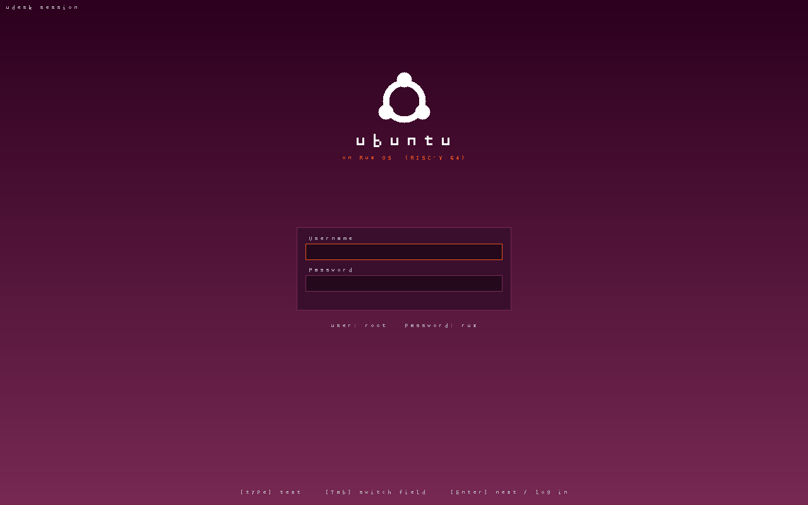
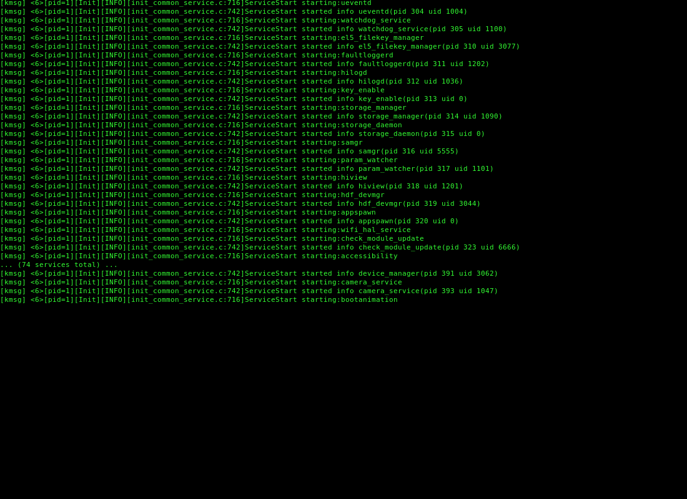

# Rux

<div align="center">

**A Linux-like OS kernel entirely written in Rust**

[](https://www.rust-lang.org/)
[](LICENSE)
[](https://github.com/rust-osdev/rust-embedded)
[](#-test-status)
[](docs/architecture/structure.md)

**Platforms: RISC-V 64-bit (RV64GC, primary) · x86_64 (q35)**

</div>

---

## 🖥️ Rux Runs Ubuntu

**A complete Ubuntu 22.04 userland — glibc dynamic binaries, real shells, D-Bus,
Xorg with client windows, an interactive xterm, and a real GNOME Shell desktop
(gnome-shell + mutter compositing) — boots on the Rux kernel today, on both
riscv64 and x86_64.**

| | |
|---|---|
|  |  |
| *Ubuntu GNOME login screen on Rux (riscv64) — verify.py 23/23 PASS* | *Ubuntu GNOME desktop on Rux (riscv64) — the full udesk session with dock, panel, and apps* |

What runs, end to end:

- **Ubuntu 22.04 rootfs** with glibc, `ld.so`, and dynamic ELF loading
- **GNOME Shell desktop frames, reproducible across boots** — panel, clock,
  notification banners, and readable window content, verified by deterministic
  pixel math on riscv64 (the [Roadmap](docs/progress/roadmap.md) tracks the
  interactivity milestone)
- **Xorg completes full initialization** and serves X clients through
  `/tmp/.X11-unix/X0`; X client windows render to the screen
- **Interactive xterm** (pty + real bash/dash inside), keyboard and pointer
  input reaching X clients via virtio-input → evdev with IRQ-driven delivery
- **D-Bus (system + session), POSIX signals with full nesting semantics,
  SysV IPC, 4-CPU SMP** with cross-core TLB shootdowns
- **Linux ABI by design**: `uname` and `/proc/version` intentionally report
  Linux-compatible strings — that identity is what lets unmodified
  Ubuntu/glibc binaries run without patches

```bash
make ubuntu-image    # build the Ubuntu 22.04 GUI disk image (work/ubuntu-gui.img)
make ubuntu-run      # boot it: native SDL window + keyboard + mouse, 4 CPUs, MTTCG
                     # boot-to-login ~4.5s; login: root / rux
python3 test/ubuntu-gui/verify.py --runs 2 --smp 4   # 23 pixel-level checks per boot
```

---

## 📱 Rux Runs OpenHarmony

**The OpenHarmony x86_64_virt emulator boots with ~80 system services up
(samgr, foundation, render_service, hilogd, appspawn, hdf devhosts, …),
`hdc shell` reaches the live guest, and OH's own bootanimation renders
fullscreen on the kernel's virtio-GPU DRM path. The launcher chain has
reached MainAbility loading — spawn completes end to end, the ability
managers narrate real work — the launcher UI is not on screen yet.**

| | |
|---|---|
|  |  |
| *OpenHarmony x86_64_virt — ~80 system services start and stay up* | *OH's own bootanimation on the Rux DRM path (720×1280 virtio-GPU) — BootAnimationController verified at 150 frames* |

The kernel work behind it (full campaign in git history and the
[Roadmap](docs/progress/roadmap.md); the iconic few):

- **Binder with OH semantics**: packed token/cookie layouts, death
  notification, thread-pool growth (`BR_SPAWN_LOOPER`) and child-thread
  drain routing matching the reference protocol
- **SELinux-adjacent surfaces**: `SO_PEERSEC` on AF_UNIX (init's
  parameter service gates every `bootevent.*` set on it)
- **Memory model**: PFN span sized by the max region end, full-map zone
  seeding, page cache with a real LRU scaling to RAM
- **ext4**: recursive biglock, HANDOFF fairness, directory-entry
  mutation serialization

```bash
./test/run-oh.sh ~/oh-images console     # serial console
./test/run-oh.sh ~/oh-images gui         # virtio-gpu at 720×1280
```

---

## 🤖 AI Generation Statement

**This project's code is developed with AI assistance (Claude Code +
GLM-5.3).**

- Uses AI coding agents for assisted development
- Follows POSIX standards and maintains 100% Linux ABI compatibility
- Aims to explore the possibilities and limitations of **AI-assisted OS
  kernel development**

---

## 🎯 Project Goals

### ⚠️ Core Principle: Full POSIX/ABI Compatibility

**Core Objective**: A Linux-compatible OS kernel written in Rust

- ✅ **100% POSIX Compatible** - Full compliance with POSIX standards
- ✅ **Linux ABI Compatible** - Can run native Linux userspace programs directly
- ✅ **System Call Compatible** - Uses Linux system call numbers and interfaces
- ✅ **Filesystem Compatible** - Supports ext4 and other Linux filesystems
- ✅ **ELF Format Compatible** - Executable format identical to Linux

**Design Philosophy**:
- External interfaces must be 100% compatible with Linux
- Internal implementation can use better designs when they don't affect
  compatibility — advantageous divergences are recorded in the
  [design-divergence register](docs/architecture/design-divergences.md)

---

## 📊 Project Status

| Metric | Value | Details |
|--------|-------|---------|
| **Source Lines** | ~249,500 lines in kernel/src (399 files) | [Review Coverage Map](docs/development/review-coverage.md) |
| **Kernel Unit Tests** | 1,122 cases, all green | `make test` |
| **Formal Verification** | 4 tools, 1,116+ test functions; 157 Kani proofs | [Verification Design](docs/development/formal-verification.md) |
| **Linux LTP** | **1,005 / 1,869** (r15; trend 35 → 524 → 801 → 945 → 1,005) | [Roadmap](docs/progress/roadmap.md) |
| **Platform Support** | RISC-V 64-bit + x86_64 (q35), 4-CPU SMP | [Roadmap](docs/progress/roadmap.md) |
| **Syscall Numbers** | 345+ dispatched | [Roadmap](docs/progress/roadmap.md) |
| **Ubuntu Userland** | GNOME Shell desktop frames reproducible on riscv64; Xorg + xterm + D-Bus | [Screenshots](#️-rux-runs-ubuntu) |
| **Memory** | Swap active: 2,064 MiB anonymous working set paged through 256 MB swap, verified | [Roadmap](docs/progress/roadmap.md) |
| **Boot Performance** | MTTCG default (`thread=multi`): boot-to-login ~4.5s | [Roadmap](docs/progress/roadmap.md) |

---

## 🚀 Quick Start

### Prerequisites

```bash
# Rust toolchain (nightly recommended)
rustc --version
cargo --version

# QEMU system emulator
qemu-system-riscv64 --version

# RISC-V target (primary)
rustup target add riscv64gc-unknown-none-elf

# x86_64 target (optional)
rustup target add x86_64-unknown-none
```

### Build and Run

```bash
# === Ubuntu desktop (highlight) ===
make ubuntu-image    # build the Ubuntu 22.04 GUI disk image
make ubuntu-run      # boot Ubuntu in a native window (4 CPUs, keyboard + mouse)

# === Musl/minimal userland ===
make build           # build kernel
make user            # build userspace programs (shell, apps, toybox)
make rootfs          # build rootfs image
make run             # boot to shell

# === Verification ===
make test            # in-kernel unit tests (QEMU)
make verify          # proptest invariant checks
make kani            # Kani symbolic verification
make miri            # Miri UB detection
make spin            # SPIN concurrency model checking
```

For detailed instructions: [Getting Started Guide](docs/guides/getting-started.md)

---

## 📁 Project Structure

```
Rux/
├── kernel/                 # Kernel source (~249,500 lines in src/)
│   ├── src/
│   │   ├── fs/           # Filesystem: ext4, jbd2, devfs, procfs, tmpfs, sysfs
│   │   ├── arch/         # riscv64 + x86_64 (MM, boot, trap, uaccess)
│   │   ├── drivers/      # virtio (blk/net/gpu/input), GPU, evdev, PCI
│   │   ├── mm/           # zone/vmemmap/buddy/slab, VMA, page fault, COW, swap
│   │   ├── syscall/      # 345+ system calls
│   │   ├── ipc/          # System V, POSIX MQ, pipes, binder
│   │   ├── net/          # TCP/UDP/IPv4 stack, sockets, netlink
│   │   ├── sched/        # CFS, RT (FIFO/RR), Deadline (EDF+CBS), SMP
│   │   ├── process/      # tasks, exec, signals, coredump
│   │   ├── sync/         # futex, wait queues, rwlock, condvar
│   │   ├── dfx/          # kallsyms, tracepoint!, pstore, perf_event_open,
│   │   │                 #   syscost, oops/panic policy, per-switch probes
│   │   └── tests/        # in-kernel unit tests (1,122 cases)
│   └── build.rs
├── userspace/            # mrsh, GUI apps, smoke tests, LTP, toybox
├── toolchain/            # musl toolchains
├── docs/                 # 📚 Documentation center
└── test/                 # test programs and drivers
```

Detailed structure: [Project Structure Documentation](docs/architecture/structure.md)

---

## ✨ Key Features

- **Process Management**: fork/execve/wait4/signal handling/CFS scheduler/clone flags/gettid
- **Memory Management**: Sv39 page tables/zone allocator/vmemmap/PCP/COW/demand paging/ASID/MAP_PRIVATE COW/swap (>2 GiB verified)/LRU page cache/OOM killer
- **Filesystem**: ext4 (metadata_csum, journaling, crash recovery)/procfs/devfs/tmpfs/sysfs
- **IPC**: System V semaphores/message queues/shared memory, POSIX message queues, pipes, epoll/select/poll/eventfd, futex
- **Binder**: the OH binder protocol — transactions, node ownership, thread pools, async slots — running the full OH service stack
- **Device Drivers**: virtio-blk/net/gpu/input, framebuffer, evdev with IRQ-driven delivery, PCI ECAM rescan/hotplug
- **Network Stack**: TCP/UDP/IPv4/ARP/socket API/AF_PACKET/netlink/udhcpc bring-up/io_uring
- **SMP Multi-core**: 4-core support/load balancing/IPI/per-CPU idle tasks
- **Observability (DFX)**: kallsyms, tracepoint!-based tracefs events, pstore (console/dmesg ramoops), perf_event_open (software events, IP samples), oops/panic= policy, syscost accounting, per-switch probes — reference-kernel interface shapes throughout
- **Security**: capabilities/LSM framework/signal/file/IPC permission checks
- **POSIX Timers**: timer_create family, timerfd, setitimer/getitimer

---

## 📚 Documentation

- **[Getting Started](docs/guides/getting-started.md)** - Up and running in 5 minutes
- **[Roadmap](docs/progress/roadmap.md)** - Milestones and current status
- **[Design Divergences](docs/architecture/design-divergences.md)** - advantageous internal divergences from the mainstream, kept under the compatibility gate
- **[Lock Ordering](docs/architecture/lock-ordering.md)** - kernel lock hierarchy and nesting rules
- **[Review Coverage Map](docs/development/review-coverage.md)** - code-review coverage across kernel/src
- **[Changelog](docs/progress/changelog.md)** - version history
- **[Development Workflow](docs/guides/development.md)** - code standards
- **[Formal Verification](docs/development/formal-verification.md)** - 4-layer verification strategy

---

## 🧪 Test Status

**Total: ~4,250 test cases + formal verification proofs**

| Test Suite | Cases | Run Command | Environment |
|------------|-------|-------------|-------------|
| **Kernel Unit Tests** | 1,122 | `make test` | QEMU (no_std, custom harness) |
| **Formal Verification** | 1,116 | `make verify` | Host (std, proptest) |
| **Linux LTP** | 1,869 | guest-side runner | QEMU |
| **Smoke Tests** | 15 | `make run` → `/test/smoke_test` | QEMU |
| **Kani Proofs** | 157 | `make kani` | Host (Kani/CBMC, all-input symbolic) |
| **SPIN Models** | 4 | `make spin` | Host (SPIN/Promela, concurrency) |
| **Miri UB Detection** | - | `make miri` | Host (Miri, undefined behavior) |

### Linux LTP (1,869-test list, guest-side runner)

Full sweeps, newest first: **1,005 (r15)** ← 945 (r14) ← 801 ← 795 ← 771 ← 721
← 673 ← 659 ← 524 ← 35. Each round's fix batches are in git history; the
residual failures are feature gaps (hugemmap/fanotify/quotactl families) and
musl-artifact families, tracked in the [Roadmap](docs/progress/roadmap.md).

### Formal Verification (4 layers)

| Layer | Tool | What It Verifies | Cases |
|-------|------|------------------|-------|
| **L1: Property Testing** | proptest | Data structure invariants (randomized) | 1,088 |
| **L2: Symbolic Verification** | Kani | Core unsafe safety (all inputs, SAT/SMT) | 157 harnesses |
| **L3: Concurrency** | SPIN/Promela | Deadlock-free, no lost wakeup, preempt balance | 4 models |
| **L4: UB Detection** | Miri | Undefined behavior in test code | CI gate |

Details: [Formal Verification Design](docs/development/formal-verification.md)

---

## 🤝 Contributing

Contributions are welcome! Please check the [Roadmap](docs/progress/roadmap.md)
for tasks that need help, and the
[Development Workflow](docs/guides/development.md) for standards.

**Core Principles**:
- ✅ Strictly follow POSIX standards and Linux ABI
- ✅ External interfaces must be 100% compatible with Linux
- ✅ Internal implementation can use any design approach

---

## 📄 License

MIT License - See [LICENSE](LICENSE) for details

---

## 🙏 Acknowledgments

This project is inspired by:

- [Linux Kernel](https://www.kernel.org/)

---

<div align="center">

**Made with ❤️ and Rust + AI**

[Project Home](https://github.com/topkernel/rux) • [Issue Tracker](https://github.com/topkernel/rux/issues)

</div>
