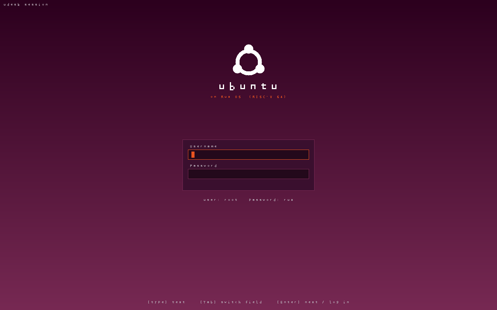
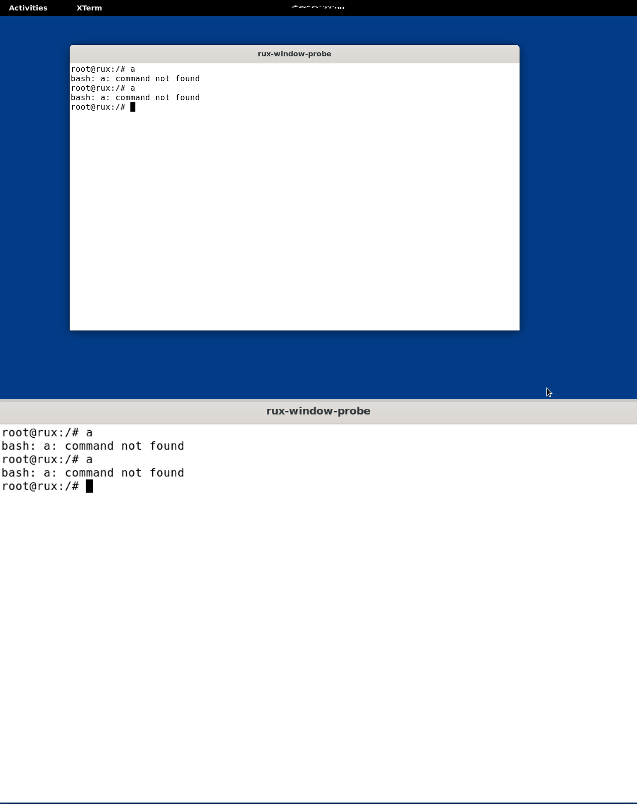

# Rux

<div align="center">

**An OS kernel written in Rust that is binary-compatible with Linux —
and free to be a better kernel inside.**

[](https://www.rust-lang.org/)
[](LICENSE)
[](#-platforms)
[](#-test-status)
[](docs/architecture/structure.md)

</div>

---

## What Rux is

Rux is a general-purpose operating-system kernel, ~250,000 lines of `no_std`
Rust, that runs **unmodified Linux userlands**: a stock Ubuntu 22.04
rootfs boots to a GNOME Shell desktop, a stock OpenHarmony emulator image
boots to its full ~80-service system, and the Linux Test Project runs
against the same syscall surface — **without recompiling, patching, or
relinking a single userspace binary**. Compatibility is not a porting
layer; it is the contract the kernel is built to: Linux syscall numbers
and semantics, the ELF loading rules, `/proc`/`/sys`/`debugfs` shapes,
ext4 on disk, down to `uname` reporting the strings glibc's loader keys
off.

The project is built around three commitments:

### 1. The ABI is the contract — 100%, not "mostly"

Every externally visible interface is treated as a hard compatibility
promise: system calls (345+ dispatched), ELF/auxv, signals and their
nesting semantics, futex, System V and POSIX IPC, the binder protocol,
ext4 on-disk format, `/proc`/`sysfs`/`debugfs`/tracefs layouts, and the
observable behavior of each (`EINVAL` vs `EFAULT` vs success). A change
that passes its own tests but drifts from the reference semantics is a
bug. This is what lets whole distributions come up as-is — and what the
[Linux LTP suite](#-test-status) (1,005 / 1,869 and climbing) pins down
round after round.

### 2. Inside the contract, the design is ours — and where ours is better, we keep it

Binary compatibility constrains the *interface*, not the
implementation. Rux deliberately diverges from the mainstream kernel
wherever a different structure is measurably better, and every such
divergence is recorded — with its advantage, its compatibility
evidence, and its known cost — in the
[design-divergence register](docs/architecture/design-divergences.md)
(13 entries and growing). Two examples:

- **A single global run queue** instead of per-CPU run queues plus a
  cross-CPU load balancer
  ([D-1](docs/architecture/design-divergences.md)). One queue is one
  source of truth for scheduling order: no migration decisions, no
  balancer heuristics, no fairness bugs from imperfect balancing — and
  lower overhead on the few-core machines where a load balancer costs
  more than it recovers (average queue hold 5.1–6.1 µs, flat across
  load). Per-CPU queuing is the right design at high core counts; at
  ≤4 cores it is machinery without payoff.
- **A build-time kernel symbol table** baked into `.rodata`
  ([D-3](docs/architecture/design-divergences.md)):
  `kallsyms`-grade symbolization with no runtime allocation and no
  boot-order window.

The same register also records where Rust's type system eliminates
whole bug classes the mainstream fights by review: typed per-CPU
storage that makes "interrupts disabled" a property of the *type*
(D-7), lock keys as trait impls so the lock hierarchy is checked at
compile time (D-11), capability-checked file-ops tables that make a
missing operation unrepresentable (D-6).

### 3. Safety is a structure, not a hope

The kernel's unsafe surface is small, explicit, and policed:

- **~4,900 `unsafe` sites in ~250k lines** — every one local, every one
  carrying a written safety contract (`// SAFETY:` — 3,200+ contracts)
  that states the invariant the caller upholds. Uncontracted unsafe is
  a review reject.
- **Formal verification in four layers** on the core algorithms
  ([design](docs/development/formal-verification.md)):
  **Kani** symbolic proofs (157 harnesses) verify core unsafe code for
  *all* inputs, not just the inputs a test happened to try;
  **proptest** property testing (1,088+ cases) hammers data-structure
  invariants with randomized adversarial input; **SPIN** model-checks
  the concurrency protocols (deadlock-freedom, no lost wakeup — 4
  models); **Miri** screens the verification crate for undefined
  behavior.
- **Safe abstractions over the verified core**: the architecture is a
  small audited unsafe core (page tables, context switch, uaccess)
  wrapped in safe types, with everything above it written in safe Rust
  where the compiler enforces the invariants — the unsafe core shrinks
  as abstractions are proven; it does not grow with features.
- **Verification mirrors stay in sync by tooling**: the checked copies
  of kernel algorithms in the verification crate are compared against
  the kernel sources on every `make verify`, so a proof can never
  silently drift from the code it claims to cover.

The payoff shows up where it matters: the memory-management and
scheduler code that runs unmodified distros is also code whose buddy
allocator, VMA manager, refcount logic, and page-flag ops carry
machine-checked proofs.

---

## What runs on it today

### Ubuntu 22.04 — to an interactive GNOME Shell desktop

A complete Ubuntu userland — glibc dynamic binaries, real shells,
D-Bus, Xorg with client windows, an interactive xterm, and a real
GNOME Shell desktop (gnome-shell + mutter compositing) — boots on the
Rux kernel today, on both riscv64 and x86_64.

| | |
|---|---|
|  |  |
| *Ubuntu userland login screen on Rux (riscv64) — the image's lightweight udesk session, the 2026-10 bring-up gate; verify.py 23/23 PASS. The real GNOME Shell desktop is the right cell.* | *Interactive GNOME Shell desktop on Rux (riscv64) — run gnome-r21type, t=2700 s. Top: the live desktop — panel with Activities + clock, the focused xterm holding a typed shell conversation. Bottom (3x zoom of the xterm text area): an echoed `a`, bash's answer, a fresh prompt — twice — ending in a block cursor. Every claim is deterministic pixel evidence (frame diffing, a per-window XGetImage walk, a line-band decoder — no vision model in the chain): the desktop frame class reproduces across 9 boots, the typed conversation across 2 boots with identical line geometry and cursor cell, and injected keyboard/pointer events are delivered to the live session 1:1 in every run. An attribution A/B (older kernel, same image, calm host: the screen stayed dark) pins the unblock to the kernel merge-set. Sessions hold 2700 s with zero panics.* |

What runs, end to end: the Ubuntu 22.04 rootfs with glibc and `ld.so`;
Xorg completing full initialization and serving X clients through
`/tmp/.X11-unix/X0`; an interactive xterm (pty + real bash inside);
D-Bus system and session buses; POSIX signals with full nesting
semantics; SysV IPC; 4-CPU SMP with cross-core TLB shootdowns.

```bash
make ubuntu-image    # build the Ubuntu 22.04 GUI disk image (work/ubuntu-gui.img)
make ubuntu-run      # boot it: native SDL window + keyboard + mouse, 4 CPUs, MTTCG
                     # boot-to-login ~4.5s; login: root / rux
python3 test/ubuntu-gui/verify.py --runs 2 --smp 4   # 23 pixel-level checks per boot
```

### OpenHarmony — the full service stack

The OpenHarmony x86_64_virt emulator boots with ~80 system services up
(samgr, foundation, render_service, hilogd, appspawn, hdf devhosts, …),
`hdc shell` reaches the live guest, and OH's own bootanimation renders
fullscreen on the kernel's virtio-GPU DRM path. The launcher chain has
reached MainAbility loading — spawn completes end to end, the ability
managers narrate real work — the launcher UI is not on screen yet.

| | |
|---|---|
|  |  |
| *OpenHarmony x86_64_virt — ~80 system services start and stay up* | *OH's own bootanimation on the Rux DRM path (720×1280 virtio-GPU) — BootAnimationController verified at 150 frames* |

The kernel work behind it (full campaign in git history and the
[Roadmap](docs/progress/roadmap.md); the iconic few): binder with OH
semantics (packed token/cookie layouts, death notification,
thread-pool growth and child-thread drain routing matching the
reference protocol); SELinux-adjacent surfaces (`SO_PEERSEC` on
AF_UNIX, where init's parameter service gates every `bootevent.*`
set); a page cache with a real LRU scaling to RAM; ext4 with recursive
biglock, HANDOFF fairness, and directory-entry mutation serialization.

```bash
./test/run-oh.sh ~/oh-images console     # serial console
./test/run-oh.sh ~/oh-images gui         # virtio-gpu at 720×1280
```

---

## 🦾 Platforms

Three architectures, one kernel source. RISC-V 64-bit (RV64GC) is the
primary target; x86_64 (QEMU q35) runs the Ubuntu desktop; AArch64
(QEMU virt) boots through GICv3 + PSCI SMP to an interactive shell with
the full user memory-management stack (4-level TTBR0/1 walker, fork
with COW, FPSIMD context, user TLS).

| | riscv64 | x86_64 | aarch64 |
|---|---|---|---|
| Boot to shell | ✅ | ✅ | ✅ |
| Ubuntu userland / GUI | ✅ (GNOME Shell desktop) | ✅ (GNOME desktop) | bring-up |
| OpenHarmony services | — | ✅ (~80 services) | — |
| SMP | 4 CPUs | 4 CPUs | 2 CPUs |
| In-kernel test suite | ✅ 1,122 | ✅ | ✅ 1,119 |

```bash
make build                        # riscv64 (default)
make build-x86                    # x86_64
make build PLATFORM=aarch64       # aarch64 (boot needs -M virt,gic-version=3)
make test [PLATFORM=…]            # in-kernel unit tests
```

---

## 🤖 AI Generation Statement

**This project's code is developed with AI assistance (Claude Code +
GLM-5.3).** It is a sustained experiment in what AI-assisted kernel
development can reach: every line — including the memory manager, the
scheduler, and the proofs — was written under AI-agent workflows with
human direction, and the project's process (line-by-line review
coverage maps, performance gates, divergence registers) is itself
built for that collaboration.

---

## 📊 Project Status

| Metric | Value | Details |
|--------|-------|---------|
| **Source Lines** | ~249,500 lines in kernel/src (399 files) | [Review Coverage Map](docs/development/review-coverage.md) |
| **Kernel Unit Tests** | 1,122 cases (riscv64), 1,119 (aarch64), all green | `make test [PLATFORM=…]` |
| **Formal Verification** | 4 tools, 1,116+ test functions; 157 Kani proofs | [Verification Design](docs/development/formal-verification.md) |
| **Linux LTP** | **1,005 / 1,869** (r15; trend 35 → 524 → 801 → 945 → 1,005) | [Roadmap](docs/progress/roadmap.md) |
| **Syscall Numbers** | 345+ dispatched | [Roadmap](docs/progress/roadmap.md) |
| **Design Divergences** | 13 registered, each gated by compatibility evidence | [Register](docs/architecture/design-divergences.md) |
| **Memory** | Swap active: 2,064 MiB anonymous working set paged through 256 MB swap, verified | [Roadmap](docs/progress/roadmap.md) |
| **Boot Performance** | MTTCG default (`thread=multi`): boot-to-login ~4.5s | [Roadmap](docs/progress/roadmap.md) |

---

## 🚀 Quick Start

### Prerequisites

```bash
# Rust toolchain (nightly recommended)
rustc --version
cargo --version

# QEMU system emulator
qemu-system-riscv64 --version

# RISC-V target (primary)
rustup target add riscv64gc-unknown-none-elf

# x86_64 target (optional)
rustup target add x86_64-unknown-none
```

### Build and Run

```bash
# === Ubuntu desktop (highlight) ===
make ubuntu-image    # build the Ubuntu 22.04 GUI disk image
make ubuntu-run      # boot Ubuntu in a native window (4 CPUs, keyboard + mouse)

# === Musl/minimal userland ===
make build           # build kernel
make user            # build userspace programs (shell, apps, toybox)
make rootfs          # build rootfs image
make run             # boot to shell

# === Verification ===
make test            # in-kernel unit tests (QEMU)
make verify          # proptest invariant checks (+ mirror-sync check)
make kani            # Kani symbolic verification
make miri            # Miri UB detection
make spin            # SPIN concurrency model checking
```

For detailed instructions: [Getting Started Guide](docs/guides/getting-started.md)

---

## 📁 Project Structure

```
Rux/
├── kernel/                 # Kernel source (~249,500 lines in src/)
│   ├── src/
│   │   ├── fs/           # Filesystem: ext4, jbd2, devfs, procfs, tmpfs, sysfs
│   │   ├── arch/         # riscv64 + x86_64 + aarch64 (MM, boot, trap, uaccess)
│   │   ├── drivers/      # virtio (blk/net/gpu/input), GPU, evdev, PCI
│   │   ├── mm/           # zone/vmemmap/buddy/slab, VMA, page fault, COW, swap
│   │   ├── syscall/      # 345+ system calls
│   │   ├── ipc/          # System V, POSIX MQ, pipes, binder
│   │   ├── net/          # TCP/UDP/IPv4 stack, sockets, netlink
│   │   ├── sched/        # CFS, RT (FIFO/RR), Deadline (EDF+CBS), SMP
│   │   ├── process/      # tasks, exec, signals, coredump
│   │   ├── sync/         # futex, wait queues, rwlock, condvar
│   │   ├── dfx/          # kallsyms, tracepoint!, pstore, perf_event_open,
│   │   │                 #   syscost, oops/panic policy, per-switch probes
│   │   └── tests/        # in-kernel unit tests
│   └── build.rs
├── kernel/verify/         # formal verification crate (proptest/Kani/SPIN/Miri)
├── userspace/            # mrsh, GUI apps, smoke tests, LTP, toybox
├── toolchain/            # musl toolchains
├── docs/                 # 📚 Documentation center
└── test/                 # test programs and drivers
```

Detailed structure: [Project Structure Documentation](docs/architecture/structure.md)

---

## ✨ Key Features

- **Process Management**: fork/execve/wait4/signal handling/CFS+RT+Deadline schedulers/clone flags/gettid
- **Memory Management**: Sv39 page tables/zone allocator/vmemmap/PCP/COW/demand paging/ASID/MAP_PRIVATE COW/swap (>2 GiB verified)/LRU page cache/OOM killer
- **Filesystem**: ext4 (metadata_csum, journaling, crash recovery)/procfs/devfs/tmpfs/sysfs/debugfs
- **IPC**: System V semaphores/message queues/shared memory, POSIX message queues, pipes, epoll/select/poll/eventfd/timerfd, futex
- **Binder**: the OH binder protocol — transactions, node ownership, thread pools, async slots — running the full OH service stack
- **Device Drivers**: virtio-blk/net/gpu/input, framebuffer, evdev with IRQ-driven delivery, PCI ECAM rescan/hotplug
- **Network Stack**: TCP/UDP/IPv4/ARP/socket API/AF_PACKET/netlink/udhcpc bring-up/io_uring
- **SMP Multi-core**: 4-core support/IPI/per-CPU idle tasks
- **Observability (DFX)**: kallsyms, tracepoint!-based tracefs events, pstore, perf_event_open, oops/panic= policy, syscost accounting — reference-kernel interface shapes throughout
- **Security**: capabilities/LSM framework/signal/file/IPC permission checks

---

## 📚 Documentation

- **[Getting Started](docs/guides/getting-started.md)** - Up and running in 5 minutes
- **[Roadmap](docs/progress/roadmap.md)** - Milestones and current status
- **[Design Divergences](docs/architecture/design-divergences.md)** - where Rux's internal design deliberately differs, and why it is better
- **[Formal Verification](docs/development/formal-verification.md)** - the 4-layer verification strategy
- **[Lock Ordering](docs/architecture/lock-ordering.md)** - kernel lock hierarchy and nesting rules
- **[Review Coverage Map](docs/development/review-coverage.md)** - code-review coverage across kernel/src
- **[Changelog](docs/progress/changelog.md)** - version history
- **[Development Workflow](docs/guides/development.md)** - code standards

---

## 🧪 Test Status

**Total: ~4,200 test cases + formal verification proofs**

| Test Suite | Cases | Run Command | Environment |
|------------|-------|-------------|-------------|
| **Kernel Unit Tests** | 1,122 | `make test` | QEMU (no_std, custom harness) |
| **Formal Verification** | 1,116 | `make verify` | Host (std, proptest) |
| **Linux LTP** | 1,869 | guest-side runner | QEMU |
| **Smoke Tests** | 15 | `make run` → `/test/smoke_test` | QEMU |
| **Kani Proofs** | 157 | `make kani` | Host (Kani/CBMC, all-input symbolic) |
| **SPIN Models** | 4 | `make spin` | Host (SPIN/Promela, concurrency) |
| **Miri UB Detection** | - | `make miri` | Host (Miri, undefined behavior) |

### Linux LTP (1,869-test list, guest-side runner)

Full sweeps, newest first: **1,005 (r15)** ← 945 (r14) ← 801 ← 795 ← 771 ← 721
← 673 ← 659 ← 524 ← 35. Each round's fix batches are in git history; the
residual failures are feature gaps (hugemmap/fanotify/quotactl families) and
musl-artifact families, tracked in the [Roadmap](docs/progress/roadmap.md).

### Formal Verification (4 layers)

| Layer | Tool | What It Verifies | Cases |
|-------|------|------------------|-------|
| **L1: Property Testing** | proptest | Data structure invariants (randomized) | 1,088 |
| **L2: Symbolic Verification** | Kani | Core unsafe safety (all inputs, SAT/SMT) | 157 harnesses |
| **L3: Concurrency** | SPIN/Promela | Deadlock-free, no lost wakeup, preempt balance | 4 models |
| **L4: UB Detection** | Miri | Undefined behavior in test code | CI gate |

Details: [Formal Verification Design](docs/development/formal-verification.md)

---

## 🤝 Contributing

Contributions are welcome! Please check the [Roadmap](docs/progress/roadmap.md)
for tasks that need help and the
[Development Workflow](docs/guides/development.md) for standards.

**Core Principles**:
- ✅ Strictly follow POSIX standards and the Linux ABI
- ✅ External interfaces must be 100% compatible
- ✅ Internal implementation can use any design approach — better designs are registered, not apologized for

---

## 📄 License

MIT License - See [LICENSE](LICENSE) for details

---

<div align="center">

**Made with ❤️ and Rust + AI**

[Project Home](https://github.com/topkernel/rux) • [Issue Tracker](https://github.com/topkernel/rux/issues)

</div>
