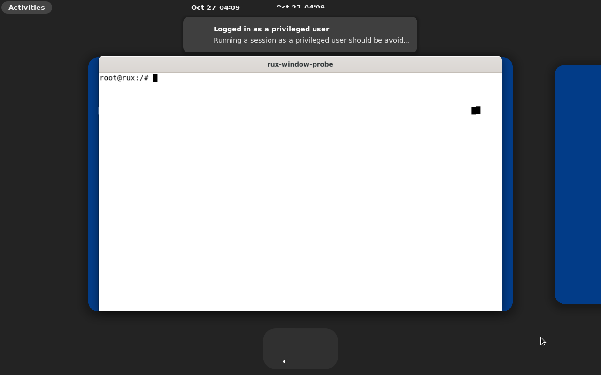

# Rux

<div align="center">

**A Linux-compatible operating-system kernel, written from scratch in Rust.**

[](https://www.rust-lang.org/)
[](LICENSE)
[](#quickstart)
[](#testing)
[](docs/architecture/structure.md)

Reports & documentation: **<https://topkernel.github.io/Rux/>** (中文 / EN)

</div>

---

## Why

Rust reached the Linux kernel in 2022, one driver at a time. A decade of
advocacy bought a handful of drivers and an ocean of C; the memory-safety
statistics that motivated the language kept pointing at the code that
stayed C. Rux inverts that ratio by starting from zero: ~392,000 lines in
which 89% is safe Rust and the remaining ~44,000 lines (10.6%) are `unsafe`
under written contract — a kernel where memory safety is the default and unsafety is a
licensed exception, rather than the reverse.

A new kernel is worthless, however, if nothing runs on it. So the second
founding decision was made before the first line of code: **the Linux ABI
is the contract** — syscall numbers and semantics, ELF and auxv, futex,
POSIX/SysV IPC, binder, on-disk ext4, the procfs/sysfs/debugfs/tracefs
layouts, down to the `uname` strings glibc's dynamic loader keys on. No
porting, no patches, no recompilation. The software the world already
ships is the acceptance test, and it is applied literally:

- **Ubuntu** boots unmodified — 22.04 to an interactive GNOME Shell desktop
  on riscv64; 24.04 through systemd 255 to multi-user and graphical targets
  on x86_64 (`make ubuntu-run`).
- **OpenHarmony** boots its full 135-service mesh to an interactive
  launcher — bootanimation, hiview, the binder mesh, the input pipeline,
  all as built by their original toolchains (`make oh-run`).

<p align="center">
  &nbsp;
  
</p>
<p align="center"><sub>Unmodified Ubuntu 22.04 (GNOME Shell) and OpenHarmony (launcher), one kernel underneath both.</sub></p>

Inside, the design is clean-room, not a translation. Where an internal
structure deliberately departs from the mainstream — a single global run
queue rather than per-CPU queues and a balancer, for one — the divergence
is [registered with its evidence](docs/architecture/design-divergences.md)
(28 entries), each gated by LTP families and unmodified-software boots.

## Performance

Every figure is measured against Linux on the same machine, the same
image, the same static binaries — alternating boots, medians. The full
boards, with method and a per-row attribution of every remaining gap:

[fio](https://topkernel.github.io/Rux/performance/fio.html) ·
[rt-tests](https://topkernel.github.io/Rux/performance/rttests.html) ·
[lmbench](https://topkernel.github.io/Rux/performance/lmbench.html) ·
[Geekbench](https://topkernel.github.io/Rux/performance/geekbench.html) ·
[microbenchmarks](https://topkernel.github.io/Rux/performance/microbench.html)

| Domain | vs Linux |
|---|---|
| ext4 durability — 4 KiB write+fsync | **1.24× faster** |
| 1 MiB buffered write | **1.19–1.25× faster** — 11.7 GiB/s at 78 µs/op |
| Directory scan — getdents, 1000 entries | **1.95× faster** |
| Pipe · context-switch · semaphore latency | **5.8× · 5.1–6.3× · 9.0× faster** |
| Real-time wake latency, cyclictest clean runs | **min and max win every clean pass; max 10× better** |
| hackbench, all three forms | **1.06–1.16× faster** |
| Geekbench 5 | **single-core 113% · multi-core 110%** |
| 4 KiB random I/O · 1 MiB direct streams | parity band, 0.83–0.97× — each row carries a measured decomposition of the gap |

The rows that trail are not excused; they are *accounted* — every remaining
microsecond has a named term and an owner.

## Safety

- **The language.** `no_std` Rust throughout; 10.6% `unsafe` lines (44,337 of 417,023), every
  token enumerated in the
  [TCB ledger](docs/development/tcb-ledger.md) under a written
  `// SAFETY:` contract. The record to date is categorical: every
  memory-corruption-class bug ever found in Rux lived inside that audited
  surface — **zero in safe code**.
- **The architecture.** Lock nesting is a compile-time fact — typed lock
  keys make reverse-order acquisition a build error, not a deadlock.
  Critical sections are measured, bounded, and guarded by a
  [tiered performance gate](docs/development/perf-gate-baseline.md);
  lock-ordering invariants are written down per subsystem.
- **The proofs.** Kani discharges core unsafe routines for all inputs;
  loom/exec models check the concurrency primitives — mutexes, PI chains,
  timers — against their invariants; 1,137+ host-side proofs run in CI.

Details: [safety & performance ledger](docs/architecture/safety-and-performance.md) ·
[security taxonomy](https://topkernel.github.io/Rux/en/security/taxonomy.html).

## Testing

| Class | Scale |
|---|---|
| LTP compatibility list | **1,139 of 1,869** |
| In-kernel suite | **1,335 cases**, every merge |
| Architectures | riscv64 · x86_64 · aarch64 — build + boot regression, every push |
| Data integrity | fio `--verify`, e2fsck, hard-kill persistence batteries |
| Stress fleet | `make ci` — 32 classes including fsfuzz, hours unattended |
| Two-sided performance | every row re-measured against Linux on the same platform |

Reports: [test index](https://topkernel.github.io/Rux/testing/index.html).

## The AI workflow

All ~392,000 lines were written by AI agents under a written constitution —
[AGENTS.md](AGENTS.md) — that binds machine and human alike: parallel
worktrees; one merge law (three-architecture build, full suite, tiered
performance gates, data-integrity verification before anything lands);
every performance claim backed by a same-machine A/B; every divergence
registered; negative results kept on record. The repository is the
cockpit: point an agent at AGENTS.md and it flies under the same law.

## Quickstart

```bash
# Toolchain: Rust nightly, QEMU; musl cross-tools bundled under toolchain/
make build                   # kernel (default riscv64)
make user rootfs             # userspace + minimal rootfs image
make run                     # boot to a shell
PLATFORM=x86_64 make build   # x86_64 / aarch64
make test                    # 1,335-case in-kernel suite
make ubuntu-run              # boot the Ubuntu desktop
make oh-run                  # boot OpenHarmony to the launcher
make ci                      # full stress pipeline, unattended
```

The serial console is the primary log (`console=ttyS0`); on panic the trap
printer emits epc/ra/sp/badaddr and stack words for
`riscv64-linux-gnu-addr2line`.
[Getting started](https://topkernel.github.io/Rux/guides/getting-started.html)
walks a first session end to end.

## Contributing

Pull requests are welcome, human or machine; the bar does not distinguish.
Build on three architectures, keep the suite green, keep performance rows
in band or attach the numbers that improved, keep the integrity batteries
clean. If your patch makes the kernel faster — show the rig.

---

<div align="center">

*One ABI, kept to the letter. One codebase, in a language that refuses
whole bug families. One bar: the software the world already ships.*

</div>
